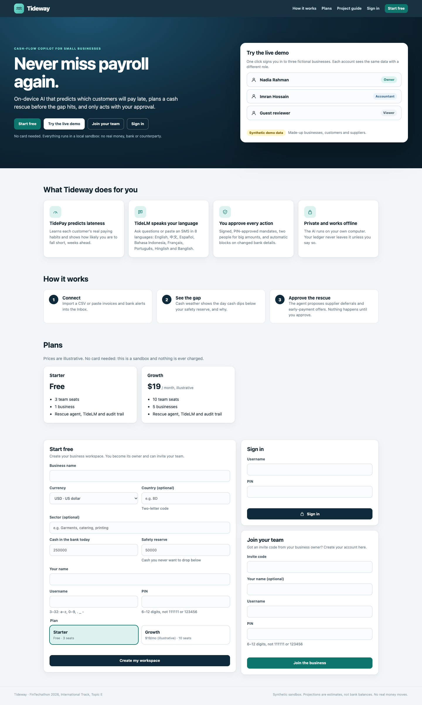

# Tideway

Latest upgrade: [clear customer payment/payroll evidence, cost-and-risk review and screening precision](docs/RELEASE_V14.md).

Judge/auditor review (17 October): [fixed defects and remaining contest gaps](docs/INDEPENDENT_AUDIT.md). Exact current verification counts and provenance: [readiness index](docs/READINESS_CURRENT.md).

[Team-reported survey results](docs/USER_STUDY_RESULTS.md): 20 SME participants and 20 security-task participants, with 10 overlapping and 30 unique people. The report records consent confirmation, calculations, source provenance and missing session/model metadata.

[Additional supplied survey records](docs/SURVEY_INTAKE_20.md): separate analyses of two later 20-row files. Collection, tested build and overlap remain unverified; these rows are not added to the earlier participant counts.



## Two-minute tour for judges

1. `python3 run.py` and open <http://127.0.0.1:8787>. Click **Nadia (Owner)** on the landing page.
2. **Cash weather**: start with Simple view. Test an expense, inspect important receipts and compare three recovery priorities. Switch to **Detailed view** for charts and **Read my brief**.
3. **Ask Tideway**: say "hi", then ask in another language, e.g. "Nila Traders 晚20天付款会怎样？". Open the plan under the answer to see exactly which tools the model chose.
4. **Rescue plan**: run the agent, then approve with PIN `2468` (and Imran `1357` for the second approval).
5. **Inbox**: paste the injection sample and watch it get flagged.
6. **Security centre**: run the self-test (every attack blocked). **Evidence**: run the tamper drill.
7. **Decision lab**: find a plan's breaking point, stress late agreements, compare recovery options, replay a private capsule or inspect the initial cloud payload. Nadia can arm the synthetic event monitor; an event changes the ledger and prepares a fresh proposal without approving it. Two-business negotiation checks supplied supplier reserve/payroll assumptions before creating an ordinary approval-gated proposal.

The role-aware **Quick start** card guides a first forecast, proposal, approval review and receipt check. Its shortcuts only navigate; they never approve or execute. Optional local-model setup is documented for Windows and macOS in [SETUP_WINDOWS_MAC.md](docs/SETUP_WINDOWS_MAC.md). Without optional model files, the deterministic local agent answers.

Tideway is a working prototype for the FinTechathon 2026 International Track, **Topic E: SME Finance Copilot** (theme: *AI as a Financial Participant*). It finds a coming cash gap, plans a recovery with an exact, risk-aware optimiser, negotiates with simulated counterparties, and moves forward only through human approval and a signed, scoped mandate. The agent can read, analyse and propose. It cannot approve or execute.

> **Honest scope.** Everything runs in a **synthetic sandbox**: fictional businesses, no real money, no bank, lender, supplier or customer connected. Financing offers are labelled **MOCK** catalogue comparisons and are never executable. The payment file (ISO 20022 pain.001) is a draft that is never sent. Passing tests and local-model smoke requests establish results for their listed cases, not security or general accuracy. The optional cloud-provider path has no measured live-provider run.

Built by **The Last BrainCell**, Bangladesh University of Engineering and Technology (BUET). See [team and submission notes](docs/SUBMISSION_NOTES.md).

## Quick start (Python 3.11+, standard library only)

```bash
python3 run.py
```

Open <http://127.0.0.1:8787>. The server binds to loopback only; do not expose it to a network.

Windows and Mac instructions: [SETUP_WINDOWS_MAC.md](docs/SETUP_WINDOWS_MAC.md). Run `python scripts/check_setup.py` to inspect optional model availability.

The optional [local-model helper](scripts/local_demo_model.py) offers checksum-pinned `compact` (~1.12 GB) and `qwen3-4b` (~2.50 GB) profiles. An explicit `--cache-dir` can place files on another drive. Model weights and native runtimes are downloaded separately and are excluded from the submission ZIP; neither profile is the released TideLM MLX adapter.

## Reproducible setup, test and local deployment

The default runtime is offline and uses only the Python standard library. The
repository pins the supported interpreter in `.python-version` and keeps the
dependency lock marker in `requirements.lock`.

[Tracked CI](.github/workflows/ci.yml) defines Windows/macOS/Linux Python checks, a Pillow lane, browser flows, package extraction checks and Docker. [CI.md](docs/CI.md) explains coverage and local reproduction. Hosted run 14 passed all nine jobs for committed v9 source `6dbb315`; that result does not attest to unpushed v10 changes. See [current readiness](docs/READINESS_CURRENT.md) for measured results and remaining team-controlled items.

```bash
# Native setup (Python 3.11.11)
python3 --version
python3 -m unittest discover -s tests -v  # also works without make
make selftest             # 30-case task and security scorecard
make build                # bytecode/compile check
make run                  # start http://127.0.0.1:8787
```

For a clean, isolated sandbox with persistent local data:

```bash
docker build -t tideway:local .
docker run --rm -p 127.0.0.1:8787:8787 -v tideway-data:/app/data tideway:local
```

The Docker image binds internally for container networking, while the example
port mapping exposes it only on the host loopback interface. No production
deployment or external service is implied.

| Role | Operator | PIN |
|---|---|---|
| Owner | Nadia | `2468` |
| Accountant | Imran | `1357` |
| Viewer | Guest | `0000` |

These PINs belong to the synthetic demo only.

```bash
python3 -m unittest discover -s tests -v   # unit, HTTP and security tests
python3 -m tideway.selftest                # 30-case scorecard (5 tasks, 25 attacks)
python3 scripts/evaluate.py                # writes evidence/results.csv, run-log.jsonl, verification-summary.json
node scripts/capture_screens.mjs           # drives headless Chrome through the demo, writes evidence/screens/
python3 scripts/build_submission_pdfs.py   # pitch, architecture and security PDFs (headless Chrome)
```

`python3 run.py --no-demo --db data/empty.sqlite3` starts an empty workspace. Node 22+ and Google Chrome are needed only for screenshots and PDFs.

## Current review improvements and one-command verification

Owner discount ceilings and ranking preferences now survive counter-offers and
replans; the server rejects above-ceiling terms and requires fresh approval for
successor plans. See [the remediation report](docs/REMEDIATION_V7.md) for the
regression evidence, paired screening runs and local package verification.
The [completion review](docs/COMPLETION_V8.md) records the subsequent Windows
verification and signed-parent replacement fix, including remaining limitations.
H11's historical fresh-draw breach estimate is 11.78% against a 10% target.
Likely-path feasibility and explicit risk acknowledgement do not make every
rescue meet that target or guarantee customer payment.

[Current readiness](docs/READINESS_CURRENT.md) is the authoritative evidence index;
older upgrade/Windows reports retain their original scope and failures.
The additional [Python 3.11 standard-library report](evidence/readiness-v3/python311/test-summary.json) records its exact version, source and optional photo skips.

```bash
python3 scripts/prepare_release.py --checks-only --evidence-dir evidence/completion-v8
python3 scripts/prepare_release.py --evidence-dir evidence/completion-v8  # also browser, PDFs, ZIP, extraction
```

The complete command needs Node 22+ and Chrome/Edge, checks one frozen LF source
tree and does not download models or call a cloud provider. Its ZIP is
`dist/Tideway-submission.zip`; inspect `dist/extraction-verification.json` and
`dist/SHA256SUMS.txt`. Use `--reuse-pdfs` to retain PDFs already visually reviewed.

The exact shipped TidePay weights now have an [unseen synthetic evaluation](docs/DEPLOYED_MODEL_EVALUATION.md).
Mock funding comparisons include total repayment, arrival timing, unverified
eligibility and reserve/payroll pressure through repayment. Above-target plans
require each approver to acknowledge the exact remaining risk; the server binds
that consent to the plan and retains it in the signed mandate and receipt.

A [sealed native macOS model challenge](docs/BLIND_EVALUATION.md) initially handled
28/32 requests correctly with no financial executions. Three amount/entity
failures prompted separate guard regressions; the original failures remain.
The subsequent [disclosed regression](evidence/readiness-v3/blind/model-post-fix-regression.json) handled 32/32; this is not a new blind score.
A separate historical [real-model browser run](evidence/readiness-v3/browser-real/browser-verification.json) verifies risk answers, payment refusal and unchanged financial state on its recorded source.
The historical v3/v5 instruction screening detected only 2/24 unfamiliar attacks
and flagged 2/24 benign messages. The historical sealed v6 first pass covers 96
independently authored synthetic cases (55 TP, 11 TN, 29 FP, 1 FN for combined
warning); the high false-positive rate and unbenchmarked compatible-model status
are disclosed in [current readiness](docs/READINESS_CURRENT.md). V7 cached-base
classification runs and their retained failures are linked in the remediation report. Structural
permissions remain essential. No real-user feedback has been fabricated: use the
[consented SME study kit](docs/USER_STUDY_KIT.md).

## Contest upgrade and reproducible evidence

The linked demo now applies a real delay to a synthetic invoice, invalidates the old approvals, and requires a fresh proposal and approval before execution. The normal What-if sliders remain read-only. Follow [the live runbook](docs/PAYMENT_DELAY_RUNBOOK.md).

```bash
python3 scripts/demo_payment_delay.py
python3 scripts/evaluate_tidepay_v2.py
python3 scripts/evaluate_upgrade_scenarios.py
python3 scripts/smoke_reasoning.py
node scripts/capture_screens.mjs --test-payment-delay --out tmp/delay-browser
```

The [audited TidePay benchmark](docs/TIDEPAY_EVALUATION_V2.md) uses 2,376 identical chronological test invoices: simulated federation MAE 6.9568 days versus heuristic 7.4107 and local-only 7.2152. Pooled training is slightly better on MAE (6.9448). Training statistics and labels are available before the cutoffs; calibration bins, class balance, per-business results and uncertainty are saved. A historical prior used test-label statistics; its original report is preserved and clearly separated. The audit benchmark does not replace the shipped model or establish real-world accuracy or cryptographic privacy.

The [scenario evaluation](docs/SCENARIO_EVALUATION_V2.md) covers 24 distinct conditions, with development and held-out sets, workflow outcomes, latency, false positives and retained misses. [The model runtime notes](docs/MODEL_REASONING_V2.md) distinguish model-selected calls from deterministic preflight and fallback. Real Windows inference with the optional Qwen3 4B compatible model matched [6/6 authored smoke requests](evidence/readiness-v2/model/qwen3-final-smoke.json) and [12/12 expanded authored requests](evidence/readiness-v2/model/qwen3-final-expanded.json), with structured plans explicitly enabled. These overlapping smoke sets are not an accuracy benchmark. Earlier compact-model failures and the 4B model's initial 5/6 result are retained. These Windows runs are historical. The current sealed macOS compatible-model observation is linked above. Native MLX/TideLM and vision inference remain outstanding; injected outputs are containment tests only.

The confirmed public roster is tracked in `submission-team.public.json`; roles and leader remain blank. The local submission builder excludes private team metadata, keys, data and caches, and the [package verifier](scripts/verify_package.py) checks fresh extraction without Git or site packages. Recording is deferred. Registration, eligibility, organiser route and reviewer access remain separate team-controlled steps; see [checked sources](docs/CONTEST_SOURCES_CHECKED.md).

## What it does

1. **Sees the gap.** Exact integer minor-unit cash projection with three scenarios (scheduled, likely, stress) and a 14-day look-ahead so a deferral cannot hide a problem just beyond the target date.
2. **Predicts when each invoice will really be paid.** TidePay, Tideway's own model (below), gives every open invoice a probability for each lateness band. The likely and stress scenarios and the Monte Carlo use it; credibility-weighted customer profiles remain as the explainable fallback.
3. **Quantifies risk.** A seeded Monte Carlo (1,000 runs; the same records and seed give the same answer) estimates the chance of breaching the reserve floor and is shown as a "cash weather" read-out.
4. **Optimises.** An exact search over supplier deferrals, early-payment discounts and zero-cash reminders finds a feasible bundle and re-checks candidates with Monte Carlo. Residual risk is displayed and server-bound acknowledgement is required when a bundle misses the 10% simulated-risk target; feasibility does not guarantee payroll or customer payment. Early-payment discounts are priced as an annual rate (2% for 20 days is about 37% APR).
5. **Negotiates.** Simulated suppliers and customers answer each request with accept, counter-offer or reject. A counter becomes a new proposal that needs fresh approval; a refusal triggers a re-plan without that counterparty.
6. **Authorises like a bank.** Maker-checker approval with PIN step-up; high-value bundles need two people (including the owner) and a typed exposure amount. Approval issues an **HMAC-signed mandate** (modelled on the AP2 mandate idea: verifiable, scoped, expiring), bound to the exact actions, snapshot, policy and expiry.
7. **Executes once, verifiably.** Idempotent execution against the sandbox, state hashes before and after, and a read-back check.
8. **Stays stoppable.** A kill switch pauses the agent (only the owner resumes, with a reason). A circuit breaker pauses it automatically after repeated security denials.
9. **Reviews fraud signals.** Changed bank details and look-alike payee names block every action on the bill. Only flagged payees can be verified: by the owner, by callback to a number on file. Whoever verified a payee cannot be the only approver of actions for it (separation of duties).
10. **Separates message text from authority.** Flagged stored text is quarantined; unknown instructions can be missed. A fresh challenge detected only 2/24 attacks. Inbox extraction is draft-only, and every field needs human review. No text or model output can approve or execute a payment.
11. **Optional cloud LLM mode.** Off by default; TideLM (below) is the on-device default. With a key and per-message consent, counterparty names are pseudonymised, record free text is never sent, and every number in the answer is checked against tool output (ungrounded numbers are flagged).
12. **Proves what happened.** A hash-chained audit log with an independent witness checkpoint (truncation is detected), and a one-click tamper drill.
13. **Dials autonomy.** Advise, Propose or Delegate. Under Delegate, a standing mandate lets the agent send zero-cash reminders only, capped per day. Moving money is never delegated.
14. **International by design.** 29 ISO 4217 currencies; demo businesses in Bangladesh (BDT), China (CNY) and Singapore (SGD); payment-detail-change and injection screening in English, Chinese, Spanish, French, Indonesian/Malay, Hindi, Bangla and Arabic, covering banks (IBAN, SWIFT, sort code) and wallets (PayPal, Wise, Alipay, WeChat Pay, UPI, PayNow, M-Pesa, GCash, Pix, bKash...). Mixed currencies inside one business are rejected.
15. **Speaks your language.** Ask in English, 中文, Español, Français, Português or Bahasa Indonesia (Hinglish and Banglish too) and get the answer in that language, with the same numbers. Greetings and status questions are answered instantly with a personal briefing, and every answer suggests the next useful question.
16. **SaaS workspaces.** Sign up a business, invite your team by one-time code with a role (owner, accountant, viewer) and seat limits per plan; every request is checked against your membership, so businesses never see each other.
17. **Counterparty risk map.** Each customer is stressed alone (30 days late; never pays) and ranked by expected cash impact using TidePay's probabilities, with supplier deferral options and fraud blocks alongside.
18. **Zero-entry Inbox.** Paste bank, card and mobile-money alerts or chat messages in many languages; TideLM drafts the records, flags injection, and nothing is saved until you confirm.
19. **Exports.** Evidence JSON, records and receipts CSV (spreadsheet-formula-safe), and a draft ISO 20022 `pain.001` for the deferred payments.

## Tideway's own AI (trained here, runs on-device)

Tideway does not depend on a third-party AI API. TidePay is trained here on synthetic data. TideLM is our LoRA adapter on the third-party Qwen3 base model. Optional TideVision uses a third-party Qwen2.5-VL model without a Tideway fine-tune. The evaluated MLX adapter requires Apple Silicon. Windows, Linux and macOS can use the deterministic assistant or an explicitly configured local compatible model server, labelled unbenchmarked. The pinned Qwen3 helper was provisioned and exercised on macOS arm64; the released MLX adapter and receipt model remain separate, unverified device paths. The initial optional model download needs internet access; cached inference is local. Compatible-model smoke results do not inherit the MLX adapter's historical scores.

| Model | What it does | How it is trained | Evidence |
|---|---|---|---|
| **TidePay** | Probability that an open invoice is paid on time, 1-7, 8-15, 16-30 or 30+ days late | Pure-Python softmax trained with **federated learning** (FedAvg) across 40 synthetic SMEs, in a single-process simulation with illustrative pairwise masks. This experiment does not provide a deployed privacy guarantee | [Exact shipped artifact](docs/DEPLOYED_MODEL_EVALUATION.md): 7,427 unseen synthetic invoices, MAE 8.5585 vs heuristic 10.2296, log loss 1.2850, sum Brier 0.6712; no-history weakness disclosed. Earlier chronological audit is a separate artifact |
| **TideLM** | (1) Turns an owner's message in English, Chinese, Spanish, Indonesian/Malay, French, Portuguese, Hinglish or Banglish into a typed tool plan; (2) turns pasted bank, card and mobile-money alerts (M-Pesa, UPI, WeChat Pay, Alipay, PayNow, DuitNow, GCash, Pix, SEPA, Faster Payments, Wise, bKash) and chat messages into draft records and flags injection | LoRA fine-tune of Qwen3-4B-Instruct (4-bit) with MLX on Apple Silicon, on 4,500 generated multilingual examples (500 validation); the 500 test examples use counterparty names never seen in training | [tidelm_report.md](evidence/ml/tidelm_report.md) (v2, eight languages): exact plans 26.7% → **96.7%**, intent 20% → **99%**, extraction F1 0.83 → **0.969**, injection flags 91.5% → **98.5%**, ~2.8 s per answer |

The language model cannot approve or execute money actions or save extracted records. Its plan passes a validator (known tools, typed arguments, names resolved against the ledger, read/propose tools only); a forbidden tool counts toward the circuit breaker. Replies are written by code from tool output, so every number comes from Tideway. Extracted records are drafts until a person confirms them. Deterministic screening adds warning signals but can miss attacks; the permission boundary does not depend on detection.

`TIDEWAY_LOCAL_STRUCTURED_PLANS=1` optionally sends a scoped JSON Schema to a supporting local text server. It improves output shape without granting permission; the same contextual validators still run. An unsupported server fails without silently retrying unconstrained output. The default is off. See [the runtime notes](docs/MODEL_REASONING_V2.md) for all retained smoke results and limitations.

```bash
python3 -m tideway.ml.train                               # TidePay: simulated federated training + report
python3 -m tideway.ml.tidelm_data                         # TideLM: generate train/valid/test data
pip install mlx-lm                                        # Apple Silicon only
python3 -m mlx_lm lora --config tideway/ml/tidelm_lora.yaml
python3 -m tideway.ml.tidelm_eval --adapter models/tidelm-adapter --out evidence/ml/tidelm_ft_eval.json
```

To use the trained adapter without training it yourself: `python3 scripts/get_tidelm.py` (downloads the deployed v2 adapter from the `tidelm-v2` release and checks its SHA-256), then `pip install mlx-lm`.

Without the adapter the app still runs; the Assistant says TideLM is unavailable and uses the deterministic local agent.

## The demo businesses

| Business | Story |
|---|---|
| Shapla Services (BDT, Bangladesh) | Payroll day. Scheduled minimum cash is BDT -10,000 on 31 Oct 2026; shortfall against the BDT 20,000 reserve is BDT 30,000. |
| Lotus Print Studio (CNY, China) | The schedule looks fine; the customers' payment habits say it is not. Includes a counter-offer. |
| Harbourline Traders (SGD, Singapore) | No safe plan exists. A changed bank account, a look-alike payee and a poisoned bill are blocked; Tideway says so and escalates. |

## Layout

```
tideway/    domain, projection, analytics (profiles, Monte Carlo), planner, counterparty,
            security (PIN, HMAC, rate limit), store (SQLite workflow + audit), service, agent, copilot, tidelm,
            server, selftest
tideway/ml/ TidePay (synthetic data, federated training) and TideLM (data, LoRA config, evaluation)
web/        vanilla JS single-page UI (no build step)
tests/      stdlib unittest suite
scripts/    evaluate.py, capture_screens.mjs, build_submission_pdfs.py
evidence/   results.csv, run-log.jsonl, verification-summary.json, screens/
docs/       brief, technical documentation, security self-assessment, evaluation plan, demo and pitch scripts, checklist, roadmap
slides/     pitch.pdf
```

## Optional LLM mode

Copy `.env.example` to `.env`, set your own `OPENAI_API_KEY` (never commit it) and restart. The model sees only pseudonyms and tool output, can call only the allow-listed read/propose tools, and has no approval, execution, SQL, shell or URL tool.

## Documents

[Technical documentation](docs/TECHNICAL_DOCUMENTATION.md) · [Security self-assessment](docs/SECURITY_SELF_ASSESSMENT.md) · [Contest security evidence](docs/CONTEST_SECURITY_EVIDENCE.md) · [Evaluation plan](docs/EVALUATION_PLAN.md) · [Demo script](docs/DEMO_SCRIPT.md) · [Pitch script](docs/PITCH_SCRIPT.md) · [Submission checklist](docs/SUBMISSION_CHECKLIST.md) · [User study kit](docs/USER_STUDY_KIT.md) · [Project brief](docs/PROJECT_BRIEF.md) · [English roadmap](docs/Tideway_FinTechathon_2026_Roadmap.pdf)

## Licence

Tideway application code: MIT. Third-party models and tools retain their own licenses, including TideVision's Qwen Research license. See `LICENSE`, `THIRD_PARTY_NOTICES` and `docs/MODEL_CARD.md`.
