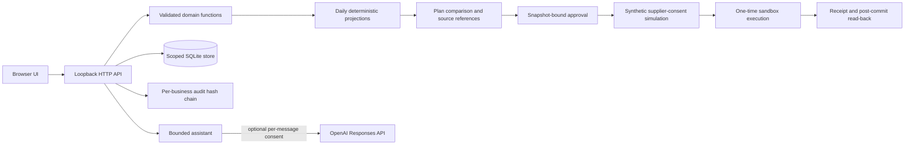

# Probaho — Technical documentation

## 1. Product scope

Probaho is an approval-gated SME cash-flow recovery prototype for FinTechathon 2026 International Track, Topic E. The first version supports one currency, a business-scoped synthetic ledger, a target-date scheduled projection, deterministic recovery comparisons, and a local sandbox. It deliberately excludes real-money transfers, production bank APIs, automatic lending decisions, and supplier communication.

The authoritative workflow is:

```text
Records → deterministic projection → explainable plan comparison
        → human approval → synthetic supplier consent simulation
        → idempotent sandbox execution → post-commit read-back → evidence
```

The default Shapla Services fixture is intentionally constructed from the roadmap example: BDT 120,000 opening cash, BDT 80,000 payroll, BDT 70,000 supplier bill, BDT 20,000 confirmed receivable, and a BDT 20,000 reserve floor. Through 31 October 2026, its base closing cash is BDT -10,000 and its reserve shortfall is BDT 30,000. A default BDT 40,000 supplier deferral places BDT 30,000 at the later synthetic date and protects the target-date reserve; the supplier still has to accept the scenario through the explicit simulation step.

## 2. Architecture



`run.py` loads local environment values and starts `ThreadingHTTPServer` on `127.0.0.1`. Static paths are an explicit allowlist. The frontend has no framework or CDN dependency. The server uses parameterized SQLite statements and closes each connection after its transaction.

## 3. Data model and scope

The store keeps separate rows for:

- `businesses`: immutable opening cash/date and synthetic flag.
- `policies`: BDT reserve floor, action limit, protected payroll setting, and version.
- `transactions`: dated income/expense records.
- `invoices`: receivables with issue, due, expected-collection date, and settlement status.
- `bills`: supplier obligations with priority and reschedulability.
- `sandbox_state`: balance, version, accepted schedules, reset count, and state hash.
- `plans`: durable comparisons bound to target date, plan hash, and snapshot hash.
- `approvals`: short-lived one-time tokens bound to plan/action/payee/amount/currency/date/hash/nonce.
- `supplier_consents`: manual synthetic acceptance or rejection bound to a specific action.
- `executions`: immutable idempotent receipts.
- `audit`: per-business SHA-256 hash chain.

Every Probaho read and mutation is business-scoped. The legacy personal-finance tables remain only for backward compatibility with an older local database; they are isolated under `legacy-personal` and are not included in the Topic E workspace list.

## 4. Deterministic projection

Money is stored as integer BDT paisa. A projection starts at `opening_cash_minor` on `opening_date` and walks each day through the selected target date, bounded to 366 days. Events before the opening date are retained for evidence but excluded from the forecast because opening cash already includes them.

```text
closing[d] = closing[d-1] + inflow[d] - outflow[d]
```

Projection scenarios:

- **base:** scheduled transactions, unpaid confirmed/overdue receivables at their expected date, and open supplier bills at their due date.
- **late_collection:** unpaid receivables move seven days later; if that is outside the target, they contribute no inflow before target.
- **approved_recovery:** accepted supplier schedule actions split an obligation exactly: original due date carries `bill - deferred_amount`, and the later date carries `deferred_amount`. A reminder has zero cash effect.

The result includes closing cash, minimum cash across all days, closing reserve shortfall, minimum reserve shortfall, first shortfall date, payroll outflow, inflow/outflow reconciliation, and source references. Paid/collected invoices are not projected again; their cash is represented by settled transactions. Payroll protection uses the transaction category or bill priority, not a free-text description.

## 5. Plan comparison

`compare_plans` produces:

1. A collection-reminder draft. It is executable as a local reminder record but has `cash_effect_minor = 0` and never changes the projected receivable.
2. A supplier-reschedule scenario. The deterministic candidate is limited by the bill amount, policy action limit, later date, reschedulability, non-payroll priority, and every-day reserve constraint. The Shapla fixture uses a 40,000 BDT deferred amount.
3. Two mock-financing catalogue alternatives. Principal, fee, repayment, term, and illustrative eligibility are displayed. They are explicitly non-executable and never create cash.

Plans carry action fingerprints and source references. A plan is not a command: it is a proposal that must be reviewed and approved by the local operator.

## 6. Approval and execution

Approval is created only through `POST /api/plan/approve`. It binds:

```text
business_id, plan_id, action_id, payee, amount_minor, currency,
target_date, plan_hash, snapshot_hash, expiry, one-time nonce,
sandbox state version, and balance at approval
```

Supplier execution additionally requires `POST /api/sandbox/consent` with `accepted: true`. This is a clearly labelled operator simulation and not a real supplier response. Execution rechecks the business, plan, snapshot, policy, bill/invoice fields, consent, state version, current balance, and action limit. It changes a synthetic schedule or creates a reminder only; the receipt always reports zero instant cash movement.

An idempotency key is unique within a business. An exact retry returns the original stored receipt, including after a new `Store` process opens the database. Reusing a key for another approval is rejected. A network-uncertain client uses `GET /api/execution` to check the receipt instead of automatically retrying.

Reset invalidates pending plans, approvals, and simulated consents and clears accepted schedules. It preserves source records and execution history. Cancellation invalidates an unused approval and never pretends to reverse an executed schedule.

## 7. Assistant boundary

Scoped conversations expose exactly four tools:

| Tool | Permission | Effect |
|---|---|---|
| `read_ledger` | `agent_read` | Returns scoped aggregates and source IDs |
| `project_cash` | `agent_read` | Returns redacted deterministic projection |
| `compare_plans` | `agent_propose` | Persists a proposal; never approves it |
| `create_reminder_draft` | `agent_propose` | Creates a local reminder draft; never sends it |

Approval and execution are absent from the model tool list. Business and target-date values are server-selected and enum-constrained in tool schemas. Tool outputs recursively redact descriptions, customer names, payees, and reminder bodies before model continuation. The provider loop is bounded to five turns and eight attempted tool calls. Malformed provider output becomes an honest provider error rather than an internal server error.

Offline mode uses the same deterministic functions and is labelled `Local demo`. It refuses approval, execution, transfers, and payment claims. Live model quality, latency, cost, and language performance remain unverified until the team runs a consented test with its own provider account.

## 8. Evidence

Each business has an independent chain whose digest includes:

```text
previous_hash | business_id | timestamp | action | permission | details_json
```

Evidence exports preserve canonical `details_json`, chain version, genesis/head hashes, permission tiers, action fingerprints, snapshot hashes, policy versions, and operator scope. This detects inconsistent edits to the recorded chain; it is not notarized, immutable, or third-party certification.

Recommended evaluation record fields are `run_id`, fixture ID, target date, snapshot hash, chosen action, policy decision, approval ID, consent ID, execution receipt, before/after state, projection before/after, pass/fail, elapsed time, and measured provider usage when available. Do not store hidden chain-of-thought or secrets.

## 9. Checks and limitations

The repository tests exact arithmetic, date/currency validation, atomic combined imports, business isolation, prompt-injection handling, approval/consent gating, snapshot invalidation, changed records, expiry, idempotency, reset/read-back, exports, and HTTP boundaries. The browser check verifies the real English UI in isolated Chrome desktop and mobile contexts.

The prototype still lacks multi-user authentication, encrypted storage, external bank connectivity, real supplier communication, formal legal/regulatory review, a production threat-model assessment, real SME user-study results, and live-model evaluation. These are limitations, not solved capabilities.
