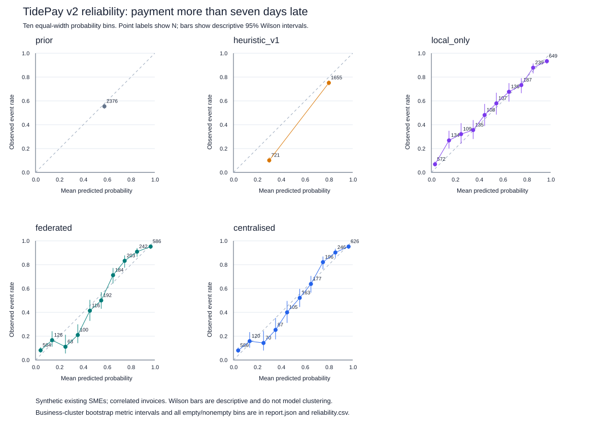

# TidePay v2: chronological prediction audit

This evaluation improves the evidence for invoice timing in Topic E's cash-flow
management. It does not replace the shipped TidePay model or retrospectively
rewrite the historical experiment. All data are generated, synthetic invoices.

## Reproduce

Python 3.11+ standard library is sufficient; no weights, API key, plotting
package or network access is required.

```bash
python3 scripts/evaluate_tidepay_v2.py
python3 -m unittest discover -s tests -p 'test_tidepay*.py' -v
```

Use `--out /tmp/tidepay-repeat` for an independent rerun. `--seed`, `--rounds`,
`--businesses` and `--bootstrap` support explicitly labelled exploratory runs.
The default configuration and seeds are saved in
[`config.json`](../evidence/upgrade-v1/tidepay/config.json). Dataset and split
hashes, source hashes, Python/OS/CPU identity, model statistics and run duration
are in [`report.json`](../evidence/upgrade-v1/tidepay/report.json). Runtime varies
by host and is not an inference-speed benchmark.

## Availability and split audit

The original `tideway.ml.train.prior_eval` used the **test delay mean** for its
prior baseline's day prediction. Its probabilities were training-only, but its
MAE had test-label leakage. The function now requires training delays. Saved
historical raw outputs in `evidence/ml/` remain intact and are labelled as the
old experiment, rather than silently regenerated.

The historical 75% per-business invoice-index split did not enforce a common
global cutoff or ensure payment labels had matured before testing began. V2
uses dates authored in the configuration before the evaluation:

| Partition | Issue-date window | Payment-label availability | N |
|---|---|---|---:|
| Train | Before 1 March 2025 | Paid before 1 March 2025 | 7,745 |
| Validation | 1 March–30 June 2025 | Paid before 1 July 2025 | 1,433 |
| Test | 1 July–21 October 2025 | Eventually observed synthetic label | 2,376 |
| Purged training labels | Training issue window | Not yet paid at training cutoff | 1,119 |
| Purged validation labels | Validation issue window | Not yet paid at validation cutoff | 1,071 |

The split manifest includes **every** generated invoice, including purged rows.
Purging selects faster-settling invoices near the boundaries; the reported
class counts show this selection. V2 does not misclassify unpaid invoices as
on-time. It is a retrospective fully labelled synthetic test, with no
real-world censoring model.

Features are available **at issue time**: only previously issued invoices paid
on or before that date enter customer/portfolio history. A prior validation or
test invoice may enter a later invoice's history after it has actually settled.
This is rolling observation, with frozen model weights and fitted statistics;
it is not refitting on held-out targets. The current invoice's paid date,
delay and latent synthetic personality never enter its feature vector.

Global class priors, mean delay, feature means/standard deviations and bucket
means use matured training rows only. The federated and pooled models use that
same pooled training scaler. Each local-only model uses **only its own SME's**
training scaler and bucket means, unlike the old pooled-statistics local
comparator. Empty local classes use fixed, documented representative days,
not another business's labels. Fixed algorithm settings are not tuned on test.
Validation is scored separately; no calibration or validation-based model
selection is fitted in this run.

## Same-record final results

Each model scores the identical 2,376 test invoice IDs from 40 existing SMEs.
The full prediction vectors and expected day forecasts are in
[`predictions.csv`](../evidence/upgrade-v1/tidepay/predictions.csv).

| Model | MAE days ↓ | Multiclass log loss ↓ | Multiclass Brier ↓ |
|---|---:|---:|---:|
| Training prior | 11.9856 | 1.5882 | 0.7936 |
| Fixed customer-history heuristic | 7.4107 | 1.5688 | 0.7905 |
| Local-only | 7.2152 | 1.2329 | 0.6407 |
| Simulated federated | 6.9568 | 1.0727 | 0.5777 |
| Pooled centralised | 6.9448 | 1.0927 | 0.5855 |

MAE is `sum(abs(expected_delay - actual_delay)) / N` in days, including negative
lateness for early payments. Log loss is `sum(-ln(p_true_class)) / N`, clipping
at `1e-15`. Brier is `sum_i(sum_c((p_ic - 1[y_i=c])^2)) / N`, **summed over all
five classes, not divided by five** (range 0–2).

The prior day prediction is the raw training mean. The original heuristic day
forecast is its issue-time credibility-weighted mean; its separate class
forecast places 0.6 on the selected bucket and 0.1 on each other bucket. That
coarse, fixed probability representation helps explain its worse probabilistic
scores; those scores alone do not establish a similarly large improvement in
cash outcomes. Softmax models use their training bucket means for expected
days. These expected-value estimators are assessed by requested MAE, although
MAE's optimal point estimator would be a conditional median.

Federated MAE improves by **0.4539 days** over this heuristic on this cohort.
The paired 95% business-cluster bootstrap interval for federated minus heuristic
MAE is **[-0.6880, -0.2568] days** (1,000 resamples, 40 SME clusters, seed 1701).
Federated MAE is better for 33/40 SMEs and worse for 7/40; the pooled model has
slightly lower aggregate MAE. Federated minus pooled MAE is 0.0120 days with
interval [-0.0786, 0.0916], so no consistent MAE advantage is established there.

## Calibration, balance and subgroup evidence



The event is **actual delay >7 days**. Ten equal-width bins use
`[0,.1), [.1,.2), …, [.9,1]`; the right endpoint belongs only to the last bin.
Each point shows mean predicted probability, observed event fraction and N.
Empty bins remain explicitly empty in
[`reliability.csv`](../evidence/upgrade-v1/tidepay/reliability.csv). Wilson 95%
bars are descriptive binomial intervals and do not account for customer/SME
correlations. The separate metric intervals resample businesses while keeping
their invoice clusters intact. No test-set calibration was fitted.

The test class counts are **605 / 454 / 538 / 512 / 267** for on-time, 1–7,
8–15, 16–30 and >30 days late; 1,317/2,376 are more than seven days late.
Per-business results, class counts and sample sizes are retained in
[`per_business.csv`](../evidence/upgrade-v1/tidepay/per_business.csv) and the JSON
report. Subgroups include five sectors, SME training size, history availability,
payment terms and invoice size relative to previous orders. Sector groups have
only eight SMEs, so their bootstrap intervals are unstable. This test has no
new customers (`history:none`, N=0); it provides no cold-start evidence.

## Scope and preserved tradeoffs

The experiment is one seed from one synthetic generator family, testing later
invoices from businesses already represented in training. Bootstrap intervals
capture business resampling within that cohort, not generator changes,
hyperparameter searches or production generalisation. Local, FedAvg and pooled
optimisers take different update paths; their compute/convergence is not
identical. No generic-LLM, real-user or real-money comparison was run.

Federation remains a **single-process FedAvg simulation**. The process holds raw
client data, pools training features for scaling and generates predictable
illustrative masks. Cancellation demonstrates arithmetic, with no deployed
cryptographic privacy guarantee. The generated v2 artifact is saved in the
evidence directory; `tideway/ml/tidepay_model.json` remains the original shipped
model. V2 scores describe this audited benchmark, not a silently updated
production model or calibrated cash-risk probabilities.
